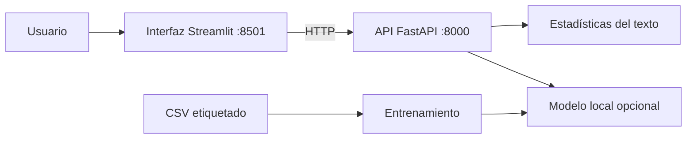

<div align="center">


# 🔎 LupaIA
### Explora señales lingüísticas. No adivines autorías.

[](https://www.python.org/)
[](https://fastapi.tiangolo.com/)
[](https://streamlit.io/)
[](https://scikit-learn.org/)
[](https://docs.docker.com/compose/)

</div>

> [!IMPORTANT]
> **Proyecto educativo y experimental.** Un detector de texto generado por IA puede equivocarse, especialmente con textos breves, estilos especializados o idiomas poco representados. Su salida **no demuestra autoría** ni debe utilizarse para sancionar o acusar a una persona. El puntaje del clasificador no es una probabilidad validada de autoría.

## ✨ ¿Qué hace?

**LupaIA** ofrece dos microservicios independientes:

- **🔧 API · FastAPI:** recibe un texto, calcula métricas descriptivas y consulta un clasificador local si fue entrenado.
- **🪄 Interfaz · Streamlit:** permite introducir el texto y consultar el resultado de la API de forma visual.

El clasificador base utiliza **TF-IDF + regresión logística (Scikit-learn)**. Se entrena con un CSV etiquetado y no requiere servicios de IA de pago ni GPU.

## 🧩 Arquitectura



## 🚀 Inicio rápido

### Opción A: Docker Compose

```bash
docker compose up --build -d
```

| Componente | Dirección local |
|---|---|
| 🖥️ Interfaz | http://localhost:8501 |
| 📘 Documentación interactiva | http://localhost:8000/docs |
| 💚 Estado API | http://localhost:8000/health |
| 🧠 Estado del modelo | http://localhost:8000/modelo |

Para ver registros: `docker compose logs -f api` y `docker compose logs -f interfaz`.

### Opción B: Python (Windows PowerShell)

```powershell
py -3.11 -m venv .venv
.\.venv\Scripts\Activate.ps1
python -m pip install --upgrade pip
pip install -r requirements.txt
```

Terminal 1 (API):

```powershell
uvicorn backend.main:app --reload --port 8000
```

Terminal 2 (interfaz):

```powershell
streamlit run frontend/app.py --server.port 8501
```

## 🧠 Entrenar un modelo propio

Crea `data/dataset.csv` en UTF-8 con dos columnas: `texto` y `etiqueta`.

| etiqueta | Significado |
|---|---|
| `0` | Texto humano de origen verificado |
| `1` | Texto generado por IA de origen verificado |

```powershell
python -m training.train --csv data/dataset.csv
```

El entrenamiento escribe `models/detector.joblib` y `models/metricas.json` localmente. Sin un modelo entrenado, la API sigue funcionando para **estadísticas descriptivas**, pero no clasifica textos.

> Un puñado de ejemplos solo valida que el programa pueda entrenarse. Para evaluar fiablemente el detector se necesitan conjuntos amplios y diversos, un test independiente y métricas de falsos positivos, F1 y sesgos por dominio e idioma.

## 📡 API

| Método | Ruta | Propósito |
|---|---|---|
| `GET` | `/health` | Comprobar que la API responde |
| `GET` | `/modelo` | Consultar si existe un modelo entrenado |
| `POST` | `/analizar` | Obtener métricas y, si existe el modelo, clasificación experimental |

Ejemplo para `POST /analizar`:

```json
{
  "texto": "Este texto es un ejemplo suficientemente largo para probar el funcionamiento del servicio de análisis."
}
```

## 🗂️ Estructura

```text
LupaIA/
├── backend/                # API y carga del modelo
├── frontend/               # Interfaz Streamlit
├── training/               # Entrenamiento reproducible
├── data/                   # Formato del dataset (sin datos sensibles)
├── models/                 # Instrucciones para guardar artefactos locales
├── tests/                  # Pruebas API y entrenamiento
├── assets/                 # Identidad visual
├── Dockerfile.api
├── Dockerfile.streamlit
├── compose.yaml
└── requirements.txt
```

## 🧪 Pruebas

```bash
python -m pytest -q
```

## 🔐 Seguridad y límites

- No publiques la API directamente sin añadir autenticación, límites de peticiones y monitoreo.
- No subas datasets privados ni texto personal a un repositorio público.
- No cargues archivos `.joblib` procedentes de fuentes desconocidas (pueden ejecutar código durante la deserialización).
- No interpretes la etiqueta del clasificador como una prueba de autoría.

---

<div align="center">
  <sub>🔎 <strong>LupaIA</strong> · Experimento abierto para aprender microservicios, NLP y evaluación responsable de modelos.</sub>
</div>
